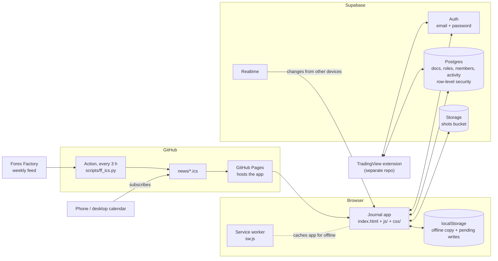

# Architecture

Trade Journal is a static web app (HTML, CSS and plain JavaScript, no framework and no build step) hosted on GitHub Pages, with Supabase for sign-in, data and screenshots. A Chrome extension logs trades straight from TradingView into the same database, and a scheduled GitHub Action publishes a forex news calendar.

## Principles

- **No server code of our own.** The browser talks to Supabase directly with the public anon key. Privacy comes from Postgres row-level security (RLS): every query only ever sees the signed-in user's rows. Admin-only operations are `security definer` functions that check `is_app_admin()` first.
- **Offline first.** Everything is kept in `localStorage` as well, so the app opens instantly and works without a connection. Writes made offline are queued and sent when the connection returns.
- **One flexible document store.** Trades, accounts, projects, reviews and settings are all JSON documents in one `docs` table. New fields need no database migration; the app gives old documents sensible defaults.
- **Additive changes only.** Database changes add tables, columns or functions and never drop data, so an older app version keeps working against a newer database.

## Code layout

The scripts are plain (non-module) scripts loaded in order from `index.html`; they share one global scope, so a file may use anything defined in a file before it.

| File | What it does |
|---|---|
| `index.html` | All markup: header, tabs, views, forms, Settings and Admin windows |
| `css/app.css` | All styles; light/dark themes and accent colours are CSS variables |
| `js/core.js` | App version, the trading plan (concepts, entries, exits), formatting and DOM helpers |
| `js/storage.js` | Supabase client, sign-in, loading/saving docs, offline queue, realtime sync |
| `js/plan.js` | Weekly/daily criteria, setup score and A/B/C grade, R and pip maths |
| `js/analyze.js` | Analyze tab (filters, comparisons, drill-down splits, charts) and the dashboard KPIs/calendar |
| `js/review.js` | Blind re-analysis of old trades, weekly/monthly period reviews, chart zoom |
| `js/settings.js` | Settings window, look, role features (`feat()`), scoring, data tools, news links, and the grade rules editor (shown in the Grading tab) |
| `js/admin.js` | Admin window: roles with features, users with roles and usage |
| `js/accounts.js` | Trading accounts and balances |
| `js/journal.js` | Journal and Backtest views: charts, tables, Belgian capital gains tax, projects and invest simulation |
| `js/forms.js` | Forex trade form (weekly → daily → 4H), invest trade form with multiple exits, screenshots |
| `share.html`, `js/share.js`, `css/share.css` | The public read-only page for one shared trade |
| `js/app.js` | CSV export, demo data, navigation, click handling; runs last and renders the app |
| `sw.js` | Service worker: network first, cached copy only when offline |
| `config.js` | Supabase URL and anon key (public by design) |
| `supabase.js` | supabase-js, vendored so the app has no CDN dependency |
| `plan.json` | The trading plan as JSON, read by the extension so both stay in sync; rebuild with `scripts/build_plan.py` |
| `supabase/schema.sql` | The database: tables, RLS policies and functions |
| `scripts/ff_ics.py` | Builds the news calendars from the Forex Factory feed |
| `scripts/build_plan.py` | Writes `plan.json` from the plan definitions in `js/` |
| `scripts/release.sh` | Bumps the version, commits and tags a release |

## Data model

`docs` holds one row per document: `(user_id, id, data jsonb, updated_at)`. What a document is follows from `data.kind`:

| `kind` | Document |
|---|---|
| *(none)* | A trade. `market` is `fx` (forex, measured in R) or `stocks` (invest, measured in % return); `mode` is `live` or `backtest`; `status` is `taken` or `missed` |
| `account` | A trading account (FTMO challenge or funded, personal, invest broker) with currency and balance |
| `project` | A backtest project; invest projects can simulate results with an account and a max per position |
| `preview` | A weekly/monthly/quarterly/yearly review with sections and notes |
| `review` | A blind re-analysis session of older trades |
| `settings` | Look and scoring preferences (synced across devices) |
| `extsettings` | The extension's own settings |

Screenshots live in the private `shots` storage bucket under `<user id>/<file>`, and are shown through short-lived signed URLs.

## Roles and features

Each user has one role (`app_members`). A role (`app_roles`) is a name plus a set of features, for example `{"grade": true, "ext": false}`. The app reads the signed-in user's role once at start and `feat("grade")` decides whether something is shown. Turning a feature off hides it but never deletes data.

| Feature key | What it controls |
|---|---|
| `ext` | Settings → Extension tab with the install guide |
| `cgt` | Belgian capital gains tax on invest accounts |
| `grade` | A/B/C setup grades everywhere, and the grade rules editor |
| `share` | Share button on forex trades (read-only links) |

Admins open **Admin** from the header to create roles, pick their features and assign roles. Usage is recorded as one row per user per day they open the app (`app_activity`); the admin list shows last active day, active days in the last 30 and the number of trades, never the trades themselves.

## Setup grades

Grades come from rules per weekly phase (`gradeOf` in `js/plan.js`), which the user edits in the Grading tab and which are stored in the `settings` document as `gradeRules`. For the trade's phase: a missing requirement or a red-flag criterion marked against gives **C** (outside your rules; the reason says which), enough extras give **A**, otherwise **B**. The inner structure and each 4H entry type can also be set per phase to "at most B" or "not valid (C)". The editor shows live how the user's own trades grade under the current rules.

## Share links

A forex trade can be shared as a read-only page, `share.html?t=<token>`. The `shares` table holds one random token per shared trade (owner-only RLS). The page needs no sign-in: it calls `shared_trade(token)`, a security definer function that returns only the fields meant for viewing (analysis, result, notes, screenshots; never the account or project), and a storage policy lets anyone read screenshots that belong to a shared trade. Stop sharing deletes the token, so the old link stops working; the trade itself is untouched.

Chat apps build link previews from `og:` tags and don't run JavaScript, so links go through a small Cloudflare Worker (`worker/share-worker.js`, address in `config.js` as `shareBase`). For `/t/<token>` it fetches `share.html` from GitHub Pages and adds preview tags for that trade (pair, direction, result, phase, concept, a chart image). The Worker code is pasted into the Cloudflare dashboard by hand; it uses only the public anon key.

## News calendar

A GitHub Action runs `scripts/ff_ics.py` every three hours. It reads the Forex Factory weekly feed for the major currencies, classifies events (Heavy = rate decisions, NFP, headline CPI, and central bank statements and press conferences; then High and Medium) and writes `.ics` files to `news/`, keeping the past eight weeks. Calendar apps subscribe to those files on GitHub Pages; the app's Settings → News builds the subscribe links.

## TradingView extension

A Manifest V3 Chrome extension (repo `TradeJournal-Extension`). A panel on the TradingView chart walks through the same analysis as the app, switches timeframes and takes snapshots, reads dates and prices from the Long/Short Position tool, and saves the trade into `docs` with the user's own session. In bar replay it can skip ahead to the candle that touches a drawing. It reads `plan.json` from this site so its options match the app.

## Releases

The version is shown at the bottom of Settings → Data. To release: add a section to `CHANGELOG.md`, run `scripts/release.sh X.Y.Z`, then `git push && git push --tags`. The new version number also changes the service worker, which makes installed apps pick up the update.
