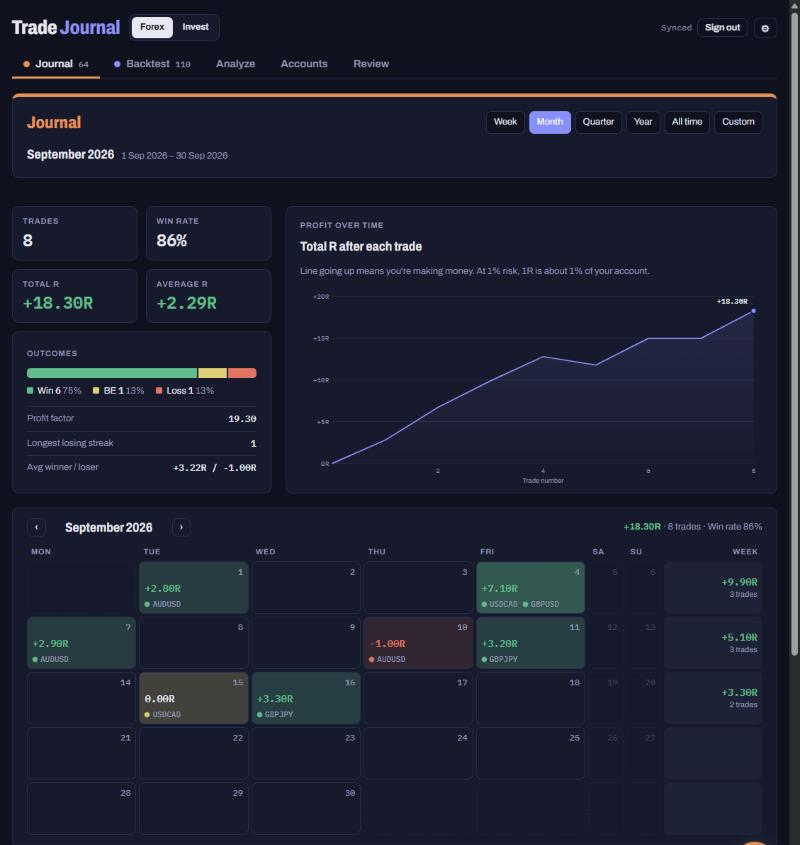
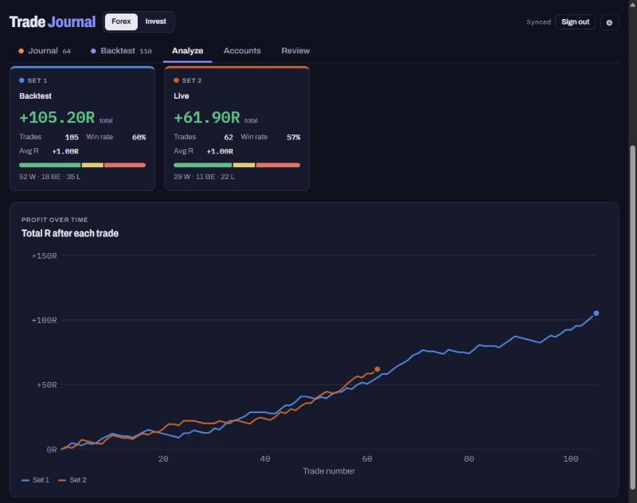

# Trade Journal

**[Open the app → dashicledev.github.io/TradeJournal](https://dashicledev.github.io/TradeJournal/)**

A trade journal and backtesting app I built for my own forex and stock trading, built around my own trade plan. I use it daily to log live trades, run backtest projects and review what works.

  
  

Screenshots use demo data.

## What it does

- **Live** and **Backtest**: log trades with the plan's analysis per timeframe (weekly phase, daily, 4H entry), result in R, exit reason, notes and chart screenshots. Backtests are grouped in projects.
- **Analyze**: equity curves and stats, filtered and split by pair, phase, concept, setup grade and more.
- **Review**: step through trades one by one to review them against the plan.
- **Accounts**: challenge and personal accounts, plus a separate **Invest** section for stocks and ETFs, kept apart from forex.
- **News calendar**: subscribable calendar files with heavy, high and medium impact forex news, with reminder variants.
- **TradingView extension**: [TradeJournal-Extension](https://github.com/DashicleDev/TradeJournal-Extension) logs trades and chart snapshots straight from TradingView into this journal.
- Installable as an app (PWA) on desktop and phone.

## How it works

- **Frontend**: a static single-page app (plain HTML, CSS and JavaScript, no framework or build step), hosted on GitHub Pages.
- **Backend**: [Supabase](https://supabase.com).
  - Auth for login.
  - One `docs` table that stores each trade, account and setting as a JSON document per user. Row-level security makes sure every user only sees their own rows.
  - Storage for screenshots, served through signed URLs.
  - Realtime, so changes sync instantly between devices.
  - Roles and feature flags to roll out features to testers first.
- **Offline cache**: data is cached locally and synced when the connection is back.
- **News pipeline**: a GitHub Actions workflow runs `scripts/ff_ics.py` (Python) every 3 hours. It pulls the Forex Factory weekly feed, filters the major currencies and builds the `.ics` files in `news/`, which GitHub Pages then serves.
- **Trade plan**: `plan.json` holds the plan's concepts, entries and exits, shared with the extension so both stay in sync.

More detail: **[ARCHITECTURE.md](ARCHITECTURE.md)** (diagram, code layout, data model, roles and features), **[CHANGELOG.md](CHANGELOG.md)** and **[supabase/schema.sql](supabase/schema.sql)** (the database with its row-level security).

## Repo layout

- `index.html`: the app's markup
- `css/app.css`: styles (light/dark themes and accent colours as CSS variables)
- `js/`: the app, split by area (`storage`, `plan`, `analyze`, `review`, `settings`, `admin`, `accounts`, `journal`, `forms`, `app`); plain scripts, no build step
- `config.js`: Supabase project URL and anon key (public by design; access is enforced by row-level security)
- `supabase.js`: supabase-js 2.117.3 (UMD, vendored)
- `supabase/schema.sql`: tables, row-level security policies and functions
- `plan.json`: trade plan options, rebuilt from `js/` with `scripts/build_plan.py`
- `scripts/ff_ics.py`, `.github/workflows/news.yml`, `news/`: news calendar pipeline
- `sw.js`, `manifest.webmanifest`, `icons/`: install as an app

## Run locally

Any static file server works, e.g. `python3 -m http.server 8000`, then open http://localhost:8000.

## Releases

Add a `## X.Y.Z — date` section to `CHANGELOG.md`, run `scripts/release.sh X.Y.Z`, then `git push && git push --tags`. The version shows at the bottom of Settings → Data. Code style: [Prettier](https://prettier.io) with `.prettierrc.json`.

## About

Built by Willem Driessen with AI-assisted development (Claude).
